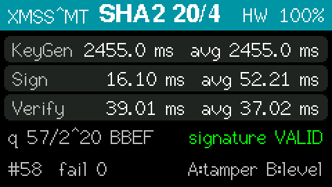

# sp800-208-xmss-esp32

Stateful hash-based post-quantum digital signatures for ESP32: **XMSS** (eXtended Merkle Signature Scheme) and its multi-tree variant **XMSS^MT**, as specified in [RFC 8391](https://datatracker.ietf.org/doc/html/rfc8391) and approved by NIST in **SP 800-208**. Supports **all 36 SP 800-208 parameter sets**: SHA-256, SHA-256/192, SHAKE256/256 and SHAKE256/192; XMSS with tree heights 10, 16 and 20; XMSS^MT with total heights 20, 40 and 60 in 2-12 layers.

The library manages the private key **state**: the signature index is written to NVS *before* each signature is computed, interrupted operations never lead to a one-time key being used twice, and XMSS^MT keys are generated the way SP 800-208 Section 7.2 requires (a fresh random seed per tree, every lower-tree root signed exactly once). It is the companion of sp800-208-lms-esp32 (LMS/HSS) and follows the structure of fips203-mlkem-esp32, fips204-mldsa-esp32 and fips205-slhdsa-esp32.

## Features

- **SP 800-208 parameter sets**: 12 XMSS and 24 XMSS^MT OIDs, RFC 8391 key and signature formats
- **Verified against the XMSS reference implementation** (by the RFC 8391 authors): keys and signatures of single-tree XMSS are byte-identical for all four hash functions, reference XMSS^MT signatures of all 24 sets verify, and every signature this library produces verifies with the reference code
- **SP 800-208 multi-tree key generation** (Algorithms 10' and 12'): every XMSS tree has its own random S_XMSS and SK_PRF, all share SEED; WOTS+ keys derived with PRF_keygen(S_XMSS, SEED || ADRS)
- **Crash-safe state handling**: write-ahead index updates, abandoned (never re-signed) lower trees after an interrupted tree creation, refusal of inconsistent state; tested with hundreds of simulated power losses: no one-time key was ever used twice
- **Tree caches** for fast signing; the next subtree is computed a leaf at a time while signing
- **Optional SHA hardware acceleration** (`XMSS_ESP32_HW_SHA`, off by default): **4-6× faster** for the SHA-256 sets
- **Word-oriented core**: all n-byte values are kept as big-endian 32-bit words, so SHA-256 blocks (and the accelerator's registers) are filled without byte shuffling; SHA-256 midstates for PRF and PRF_keygen in software
- **NVS storage** (`XMSS_NVS.h`), RAM storage for tests, any other storage via a 3-function interface
- **Hardware RNG**, watchdog-safe long key generation, small stack
- **Arduino-friendly** C++ classes `XMSSKey` / `XMSSMTKey`, plus a plain C API

## About XMSS and XMSS^MT

### How it works

A **WOTS+** one-time signature (Winternitz parameter 16) consists of 67 hash chains (51 for n = 24); every chain step applies the keyed hash F with a fresh key and bitmask derived from the public SEED and the step's address. An **XMSS** tree of height h authenticates 2^h WOTS+ keys (each compressed by an L-tree) with a Merkle tree; the public key is the root and SEED (68 bytes for n = 32). A signature contains the index, a randomizer r, the WOTS+ signature of the message hash and the authentication path.

**XMSS^MT** stacks XMSS trees in d layers of height h/d: the trees of layer 0 sign message hashes, every higher tree signs the roots of the trees below it. XMSSMT-SHA2_20/4_256 offers 2^20 signatures while only 4 × 32 one-time keys have to be computed at key generation.

Compared with LMS, XMSS uses bitmasks and addresses in every hash ("tweakable hash functions"), which gives tighter security proofs but makes each chain step 3 hash calls instead of 1: on the ESP32 XMSS is about 4× slower than LMS with the same tree height. Its signatures are similar in size (2.5 KB for XMSS-SHA2_10_256 vs. 2.5 KB for LMS H10/W4).

### Stateful signatures: the rules

Exactly as for LMS (see the sp800-208-lms-esp32 README): never copy, clone or restore a private key; storage writes must be durable; the number of signatures is limited (`remaining()`); some indices are skipped (never reused) after a reset. SP 800-208 also requires key generation and signing in a FIPS 140 level 3 hardware module; an ESP32 is not such a module, so this library is for experimentation, education and prototyping. Verification has no such restriction.

### Parameter sets

| Parameter set | n | Signatures | Signature | Public key | Notes |
|---|--:|--:|--:|--:|---|
| XMSS-SHA2_10_256 / SHAKE256_10_256 | 32 | 2^10 | 2,500 B | 68 B | key generation 24 s (HW) / 100 s (SW) |
| XMSS-SHA2_10_192 / SHAKE256_10_192 | 24 | 2^10 | 1,492 B | 52 B | |
| XMSS-*_16_* | 32 / 24 | 2^16 | 2,692 / 1,636 B | 68 / 52 B | key generation ~25 min (HW, extrapolated) |
| XMSS-*_20_* | 32 / 24 | 2^20 | 2,820 / 1,732 B | | verification only (tree height > 16) |
| XMSSMT-*_20/2_256 | 32 | 2^20 | 4,963 B | 68 B | 2 trees of height 10 |
| **XMSSMT-*_20/4_256** | 32 | 2^20 | 9,251 B | 68 B | **4 trees of height 5: 3 s key generation (HW)** |
| XMSSMT-*_20/4_192 | 24 | 2^20 | 5,403 B | 52 B | |
| XMSSMT-*_40/8_256 | 32 | 2^40 | 18,469 B | 68 B | |
| XMSSMT-*_60/12_256 | 32 | 2^60 | 27,688 B | 68 B | |
| XMSSMT-*_40/2, *_60/3 | | 2^40, 2^60 | | | verification only (tree height 20) |

All 36 sets can be verified. Key generation and signing need a tree height h/d ≤ `XMSS_ESP32_MAX_KEYGEN_HEIGHT` (default 16).

**Recommendations on the ESP32**: XMSSMT-SHA2_20/4_256 (or _192 for smaller signatures) for most uses: fast key generation, 2^20 signatures. XMSS-SHA2_10_256 for small signatures (2.5 KB) and up to 1024 signatures. The SHAKE sets are ~5× slower than the SHA-256 sets in software (~20× slower than with SHA hardware), which has no SHA-3 support.

## Requirements

- An ESP32-family board, Arduino-ESP32 core 3.x (tested: 3.3.11)
- RAM for the tree caches: 2.5-9.5 KB depending on the set (`cacheSize()`); signature buffer 1.5-28 KB
- NVS space for the state, see [Memory usage](#memory-usage): XMSS^MT stores one tree signature per lower layer, so sets with many layers need a larger NVS partition than the default 20 KB

## Installation

As for the other libraries: copy `sp800-208-xmss-esp32` into the Arduino `libraries` folder, or `--library path/to/sp800-208-xmss-esp32` with arduino-cli, or `lib_deps = file://path/to/sp800-208-xmss-esp32` in PlatformIO (`build_flags = -DXMSS_ESP32_HW_SHA` for the hardware option).

## Quick Start

```cpp
#include <XMSS.h>
#include <XMSS_NVS.h>

XMSSNvsStorage storage;
XMSSMTKey key;
static uint8_t pk[68], sig[9251];

void setup() {
  Serial.begin(115200);
  storage.begin("xmss");                         // NVS namespace
  if (key.load(storage) != XMSS_OK) {            // first boot: new key
    key.generate(storage, XMSSMT_SHA2_20_4_256);
  }
  size_t pkLen = sizeof(pk);
  key.publicKey(pk, &pkLen);

  const char *msg = "firmware v1.2.3";
  size_t sigLen = sizeof(sig);
  if (key.sign((const uint8_t *)msg, strlen(msg), sig, &sigLen) == XMSS_OK) {
    bool ok = XMSSMTKey::verify(pk, pkLen, (const uint8_t *)msg, strlen(msg), sig, sigLen) == 0;
    Serial.printf("index %llu: %s, %llu left\n", (unsigned long long)(key.nextIndex() - 1),
                  ok ? "valid" : "INVALID", (unsigned long long)key.remaining());
  }
}

void loop() {}
```

## API Reference

```cpp
#include <XMSS.h>

XMSSKey key;      int generate(XMSSStorage &storage, uint32_t oid);   // XMSS_SHA2_10_256, ...
XMSSMTKey mt;     int generate(XMSSStorage &storage, uint32_t oid);   // XMSSMT_SHA2_20_4_256, ...

int load(XMSSStorage &storage);          // XMSS_ERR_NOKEY if none, XMSS_ERR_STATE if inconsistent
int sign(const uint8_t *msg, size_t msgLen, uint8_t *sig, size_t *sigLen);  // *sigLen: in = capacity
int publicKey(uint8_t *pk, size_t *pkLen) const;
int reserve(uint64_t n);  void setAutoReserve(uint32_t n);
uint64_t remaining() const, nextIndex() const, totalSignatures() const;
size_t publicKeySize() const, signatureSize() const, cacheSize() const;
const char *name() const;  uint32_t oid() const;  const xmss_param *params() const;
void end();

static int XMSSKey::verify(pk, pkLen, msg, msgLen, sig, sigLen);     // 0 = valid
static int XMSSMTKey::verify(pk, pkLen, msg, msgLen, sig, sigLen);
static size_t XMSSKey::signatureSize(oid), XMSSKey::publicKeySize(oid);   // same for XMSSMTKey
static int XMSSKeyBase::erase(XMSSStorage &storage);
static const char *XMSSKeyBase::errorString(int rc);
```

Return codes: `XMSS_OK` or `XMSS_ERR_PARAM`, `NOMEM`, `STORE` (storage write failed; no signature was produced), `EXHAUSTED`, `RNG`, `STATE`, `BUFFER`, `NOKEY`, `INTERNAL`. XMSS and XMSS^MT OIDs overlap (both start at 1), so the key class decides how an OID is read; `XMSSKey::load` refuses an XMSS^MT key and vice versa.

Storage: `XMSSNvsStorage` (`storage.begin("namespace")`, one key per namespace), `XMSSRamStorage` (tests only), or derive from `XMSSStorage` (read / write / erase). Records: `hdr` (OID, SEED), `ctr` (next unused index), `lv0`..`lv11` (per tree: S_XMSS, SK_PRF, root, stored treeSig), `ax0`..`ax11` (tree caches, public).

C API: `src/xmss_esp32.h` (`xmss_key_generate`, `xmss_key_load`, `xmss_key_sign`, ...), `src/xmss_core.h` (`xmss_verify`, `xmssmt_verify`, parameter tables, deterministic `xmss_keygen_internal` / `xmss_sign_internal` used by the test vectors).

## Examples

| Example | Description |
|---------|-------------|
| [xmss_simple](examples/xmss_simple/) | XMSSMT-SHA2_20/4_256 key generation + sign + verify (RAM state) |
| [xmss_nvs_storage](examples/xmss_nvs_storage/) | XMSS-SHA2_10_256 key with persistent state in NVS: the index continues across resets (`r` reserve, `e` erase) |
| [xmssmt_demo](examples/xmssmt_demo/) | XMSS^MT: signs a 64 KB "firmware image", prints the layer structure of the signature, shows the new bottom tree every 32 signatures |
| [xmss_test_vectors](examples/xmss_test_vectors/) | Known-answer tests from the XMSS reference implementation (4 XMSS sets with regeneration from the seeds, all 24 XMSS^MT sets of height ≤ 10), stateful round trips |
| [xmss_benchmark](examples/xmss_benchmark/) | Key generation / signing / verification times, sizes, hash primitive speed; CSV output |
| [m5stickc-plus2](examples/m5stickc-plus2/) | Live demo on the M5StickC PLUS2 display: the key stays in NVS, the index q continues after a power cycle; button B switches the parameter set (requires M5Unified) |



*`m5stickc-plus2` example (framebuffer captured from the device, SHA hardware enabled): same layout as the ML-KEM, ML-DSA, SLH-DSA and LMS demos. Button B switches between XMSSMT-SHA2_20/4_192 ("SHA2 20/4"), XMSSMT-SHAKE256_20/4_192 ("SHAKE 20/4"), XMSS-SHA2_10_256 and XMSS-SHA2_10_192; a new key is generated, only one key is kept in NVS. The line below the cards shows the index q of the latest signature out of 2^h.*

## Performance

Measured with `examples/xmss_benchmark` on an **M5StickC PLUS2** (ESP32-PICO-V3-02 @ 240 MHz, Arduino-ESP32 3.3.11, RAM storage, 32-byte messages). Signing: average over min(256, 2^(h/d)) signatures, including the precomputation of the next subtree and, for XMSS^MT, nothing else (a new bottom tree after 2^(h/d) signatures is not included; see below).

| Parameter set | KeyGen SW | KeyGen HW | Sign SW | Sign HW | Verify SW | Verify HW | Signature |
|---------------|----------:|----------:|--------:|--------:|----------:|----------:|----------:|
| XMSS-SHA2_10_256 | 99.6 s | **23.9 s** | 131 ms | **31.6 ms** | 53.0 ms | **13.0 ms** | 2,500 B |
| XMSS-SHA2_10_192 | 94.9 s | 16.1 s | 123 ms | 21.0 ms | 52.2 ms | 8.9 ms | 1,492 B |
| **XMSSMT-SHA2_20/4_256** | 12.6 s | **3.02 s** | 93.6 ms | **22.7 ms** | 208 ms | **52.7 ms** | 9,251 B |
| XMSSMT-SHA2_20/4_192 | 12.0 s | 2.03 s | 88.3 ms | 15.3 ms | 208 ms | 37.5 ms | 5,403 B |
| XMSSMT-SHAKE256_20/4_256 | 67.6 s | - | 510 ms | - | 1.05 s | - | 9,251 B |
| XMSSMT-SHA2_20/2_256 | 199 s | 47.8 s | 131 ms | 31.6 ms | 111 ms | 25.7 ms | 4,963 B |
| XMSSMT-SHA2_40/8_256 | 25.2 s | 6.05 s | 93.9 ms | 22.9 ms | 428 ms | 104 ms | 18,469 B |
| XMSSMT-SHA2_60/12_256 | 37.9 s | 9.09 s | 94.6 ms | 23.0 ms | 630 ms | 153 ms | 27,688 B |

(SW: software SHA-256; HW: `XMSS_ESP32_HW_SHA`. The SHAKE sets do not use the hardware.)

Observations:
- **Key generation** computes every WOTS+ public key of the top tree (and of the first tree of every lower layer): 23 ms per leaf with SHA hardware, 97 ms in software (n = 32). A height-16 tree would take ~25 min with hardware (extrapolated): use XMSS^MT.
- **XMSS^MT lower trees** are generated when the previous one is used up: every 2^(h/d) signatures, one signature also generates a tree (0.75 s HW / 3.2 s SW for height 5, see `xmssmt_demo`).
- **After a reset** the tree caches are loaded from NVS in milliseconds, but the first signature recomputes the current subtree (3.4 s in software for XMSS-SHA2_10_256).
- **Verification of XMSS^MT** checks d tree signatures (d WOTS+ public keys from signatures), so it grows with the number of layers.
- XMSS costs about 4× as much as LMS per chain step (3 tweakable hash calls of 2 SHA-256 blocks each in hardware, vs. 1 block for LMS).

## SHA hardware acceleration

With `XMSS_ESP32_HW_SHA` (off by default; `build_flags = -DXMSS_ESP32_HW_SHA`, or uncomment the line in `src/xmss_esp32_config.h` for the Arduino IDE), the hash functions F, H, PRF and PRF_keygen of the SHA-256 sets are computed on the ESP32's SHA accelerator. They hash 1-3 blocks (52-128 bytes) each; the original ESP32 cannot load a midstate, so every call hashes all blocks from the initial state, but one hardware block costs ~250 CPU cycles of register traffic instead of ~5,000 for a software compression. Only H_msg (once per signature) stays in software. Speed-up: **4.0-4.2×** for key generation, signing and verification with n = 32, 5.5-5.9× with n = 24 (whose F fits one block).

Same engine sharing, self-test (here on 14 messages of 1-3 blocks) and software fallback as sp800-208-lms-esp32 / fips205-slhdsa-esp32. ESP32 (original): tested on hardware, the KAT suite passes with and without the option. ESP32-S2/S3/C3/C6: compile-tested only.

## Memory usage

- **Stack**: the benchmark task (including `Serial.printf`) peaks at 5.1 KB; the largest library buffer is the WOTS+ public key during leaf computation (67 × 32 bytes). The examples use 12-16 KB tasks for the cryptography.
- **Heap**: tree caches per tree: 2^(h'-k+1) + 2^(k+1) nodes (+ 2^k for the bottom tree), h' = h/d, k = ⌈h'/2⌉: 5,120 B for XMSS-SHA2_10_256, 3,328 B for XMSSMT-SHA2_20/4_256, 9,472 B for XMSSMT-SHA2_60/12_256.
- **NVS**: ~0.2 KB records + tree caches (2 KB per height-10 tree, 0.2 KB per height-5 tree) + one treeSig per lower XMSS^MT layer, (len + h/d) × n bytes: XMSSMT-*_20/4_192: 3 × 1.3 KB; *_20/4_256: 3 × 2.3 KB; *_40/8_256: 7 × 2.3 KB; *_60/12_256: 11 × 2.3 KB. The default NVS partition (20 KB, shared with Wi-Fi/PHY data) fits XMSS and the 20/4 sets; for 40/8, 60/6 and 60/12 use a partition table with a larger NVS partition. When NVS is nearly full, writes become slow (garbage collection) and finally fail; signing then returns `XMSS_ERR_STORE` without a signature.

## Conformance testing

There are no NIST ACVP vectors for XMSS. Testing uses the [XMSS reference implementation](https://github.com/XMSS/xmss-reference) (CC0), which implements RFC 8391 with the SP 800-208 parameter sets and PRF_keygen:
- **Byte-exact**: public keys and signatures of XMSS-SHA2_10_256, SHA2_10_192, SHAKE256_10_256 and SHAKE256_10_192 from the same seeds are identical (host: full key and signature regeneration; device: the randomizer r and the WOTS+ signature are regenerated from the seeds, the path is checked by verification).
- **XMSS^MT**: reference signatures of all 24 SP 800-208 sets with tree height ≤ 10 verify (the reference derives every tree from one seed, SP 800-208 draws a seed per tree, so only verification can be compared). Every signature produced by this library (XMSS and XMSS^MT, 9 parameter sets) verifies with the reference implementation.
- Every signature is also checked with a flipped bit, a changed message and a truncated signature.
- **Device**: `examples/xmss_test_vectors`: **177 passed, 0 failed** (172 s with SHA hardware; most of it the SHAKE round trip).
- **Host**: the same `kat_runner.h` under AddressSanitizer/UBSan with full regeneration (192 checks), and a state-machine test with random simulated power losses at storage writes, reloads and auto-reservation for 9 parameter sets (XMSS and XMSS^MT with 2, 4, 8 and 12 layers): 5,824 signatures, 348 simulated crashes, 719 reloads, every signature valid (own verifier and reference), **no one-time key used twice**.
- Regenerate the vectors with `bash scripts/gen_test_vectors.sh` (downloads and builds the reference implementation; needs gcc and the OpenSSL headers).

## Important Notes

Same as sp800-208-lms-esp32: state is everything (never restore or clone a key); flash wear (`setAutoReserve()` for frequent signing); NVS is unencrypted unless NVS/flash encryption is enabled; generate keys with an entropy source running (Wi-Fi/BT or `bootloader_random_enable()`); key generation yields every 500 ms for the task watchdog; one key object per task.

## Implementation details

| File | Purpose |
|------|---------|
| `src/xmss_core.c/.h` | Parameter tables (36 OIDs), tweakable hash functions on 32-bit words (SHA-256 midstates, hardware path, SHAKE256), WOTS+, L-tree, tree nodes, XMSS/XMSS^MT verification, deterministic single-tree functions for tests |
| `src/xmss_key.c`, `src/xmss_esp32.h` | Stateful key: records, write-ahead counter, SP 800-208 multi-tree creation, tree caches |
| `src/xmss_hash.c/.h`, `src/xmss_keccak.c` | SHA-256, SHAKE256 (Keccak permutation from slhdsa-c) |
| `src/xmss_hwsha.c/.h` | Optional SHA-256 hardware backend (multi-block messages) |
| `src/xmss_esp32_platform.c` | Hardware RNG, cooperative yield |
| `src/XMSS.h`, `src/XMSS_NVS.h` | C++ classes, NVS storage |
| `scripts/gen_test_vectors.sh`, `scripts/kat_gen.c` | Test vectors from the reference implementation |

**State machine**: index g; the tree of level i (0 = top = layer d-1) is tree number g >> ((d-i) × h/d), signed by leaf (tree number mod 2^(h/d)) of the level above. A lower tree is created as: *pending* record with fresh S_XMSS/SK_PRF → tree computation → treeSig of its root by the parent → tree cache and record with the signature. A pending record found after a reset skips the whole tree. Then `ctr = g + 1` is written, and only then the signature with index g is computed: idx_sig || r = PRF(SK_PRF, g) || treeSig(H_msg(r || root || g, M)) || the stored treeSigs of the layers above.

## License

Licensed under the **Apache License, Version 2.0**. The Keccak permutation (`src/xmss_keccak.c`) is taken from [slhdsa-c](https://github.com/pq-code-package/slhdsa-c) (Apache-2.0 OR ISC OR MIT). The test vectors are generated with the XMSS reference implementation (CC0).

## Links

- [RFC 8391: XMSS: eXtended Merkle Signature Scheme](https://datatracker.ietf.org/doc/html/rfc8391)
- [NIST SP 800-208: Recommendation for Stateful Hash-Based Signature Schemes](https://csrc.nist.gov/pubs/sp/800/208/final)
- [XMSS reference implementation](https://github.com/XMSS/xmss-reference)
